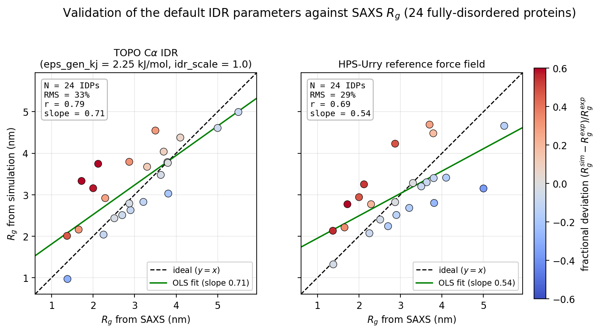

Disordered regions and intrinsically disordered proteins
========================================================

TOPO can treat part of a chain as an intrinsically disordered region (IDR) or
an entire chain as an intrinsically disordered protein (IDP). An IDR is
declared in the optional ``disordered:`` section of the same domain-definition
YAML file supplied through ``domain_def``. No separate file, argument, or INI key
is required.

This page explains:

- how to declare an IDR;
- what changes in the coarse-grained model;
- why TOPO uses an Ashbaugh–Hatch 12–6 interaction for IDR-involving pairs;
- how the ``model:`` key selects the IDR parameter set (``bt``, ``hps_urry`` or ``calvados2``);
- how IDRs affect native-contact analysis, stability optimization, and
  continuous synthesis.

.. note::
   Scope. This treatment applies only to TOPO's Cα model. It is implemented by
   :func:`topo.utils.nonbonded.apply_disorder` at the end of the
   nonbonded build. The same ``disordered:`` declaration is used automatically by
   isolated-protein simulations, native-contact (Q) analysis, the ``nscale``
   optimizer, and continuous synthesis (CSP).

Quick start
-----------

Add a ``disordered:`` block to the domain-definition file:

.. code:: yaml

   n_residues: 283

   intra_domains:
     A: {residues: [25-149], nscale: 1.0}
     B: {residues: [150-283], nscale: 1.0}
   inter_domains:
     A-B: 0.5

   disordered:
     residues: [1-24, 150-165]
     model: bt            # bt (default) | hps_urry | calvados2

``model`` names the IDR parameter set. It is optional and defaults to ``bt``, the
SAXS-calibrated set, so listing only ``residues`` gives the same result. The other
shipped sets are ``hps_urry`` and ``calvados2``; see :ref:`idr-models` before using
them.

The former ``idr_scale`` and ``eps_ev_kj`` keys have been removed. The well
depths and the energy scale are fixed by the model and cannot be set in the YAML
file. A file that still contains either key is rejected with an error that names
the key and points to ``model:``.

Declaring a residue disordered has one central consequence:

   Its native Gō contacts are removed and replaced by weak,
   sequence-dependent, non-native interactions, while excluded volume and the
   transferable backbone remain active.

Bonds, angles, dihedrals, and electrostatics are not changed.

Physical picture
----------------

An IDR model must represent two distinct physical properties:

1. Excluded volume: every residue has a finite size, so two beads cannot
   occupy the same space.
2. Residue-dependent attraction: different residue pairs can have different
   weak tendencies to associate.

A useful analogy is a solid ball with an adjustable sticky surface. The hardness
and size of the ball determine whether particles can overlap; the surface
stickiness determines how strongly they attract after approaching one another.

For IDRs, these properties should be tunable independently. A polar pair may be
only weakly attractive, but its beads must not become smaller or easier to
overlap. Conversely, strengthening hydrophobic attraction should not
simultaneously inflate the repulsive core.

This separation is particularly important for IDPs. Unlike a folded protein,
an IDP has no single native structure stabilized by a fixed contact network. Its
dimensions emerge from a delicate balance among:

- excluded volume;
- weak residue–residue attraction;
- electrostatic attraction and repulsion;
- backbone conformational entropy;
- solvent-mediated effects.

Small changes in that balance can move an ensemble from expanded to compact.

What marking a region as disordered changes
-------------------------------------------

TOPO already uses a transferable, non-Gō local backbone for every residue:

- 3.81 Å bonds;
- a double-well transferable angle potential;
- the Karanicolas transferable dihedral potential.

Folded structure is encoded through native Gō contacts. Marking a region
disordered therefore removes every native contact involving that region and
replaces it with a weak interaction that does not encode a particular fold.

Every nonlocal residue pair belongs to one of three classes:

+---------------+----------------+-------------+-----------------------------+--------------------+
| Pair class    | Nonbonded      | Native      | Well depth                  | Well position      |
|               | potential      | contacts    |                             |                    |
+===============+================+=============+=============================+====================+
| Folded–folded | Gō 12–10–6     | Retained    | Existing native-contact     | Native Cα          |
|               |                |             | energy, or the non-native   | distance, or the   |
|               |                |             | floor                       | Karanicolas–Brooks |
|               |                |             |                             | sum rule           |
+---------------+----------------+-------------+-----------------------------+--------------------+
| IDR–IDR       | Ashbaugh–Hatch | Removed     | ``λij ε``, with ``λij``     | Sum of the two     |
|               | 12–6           |             | from the model's table      | residue radii      |
+---------------+----------------+-------------+-----------------------------+--------------------+
| Folded–IDR    | Ashbaugh–Hatch | Removed     | Same rule as IDR–IDR; the   | Sum of the folded  |
|               | 12–6           |             | folded residue takes ``λ``  | and IDR residue    |
|               |                |             | by its residue type         | radii              |
+---------------+----------------+-------------+-----------------------------+--------------------+

The non-native energy floor of the folded model is not applied to IDR-involving
pairs: their well depth is exactly :math:`\lambda_{ij}\varepsilon`.

The two potentials act on disjoint OpenMM interaction groups:

- the 12–10–6 force evaluates ``{folded} × {folded}``;
- the Ashbaugh–Hatch force evaluates ``{idr} × {idr}`` and
  ``{idr} × {folded}``.

Consequently, each pair is evaluated exactly once. This is important because
OpenMM takes the union of a force’s interaction groups. If the same pair were
admitted to both forces, OpenMM would add both potentials without raising an
error.

.. _idr-ashbaugh-hatch:

How IDR-involving pairs interact: the AH lambda form
~~~~~~~~~~~~~~~~~~~~~~~~~~~~~~~~~~~~~~~~~~~~~~~~~~~~

Define the dimensionless Lennard–Jones shape

.. math::

   L(r)=4\left[
   \left(\frac{\sigma}{r}\right)^{12}
   -
   \left(\frac{\sigma}{r}\right)^6
   \right],

with

.. math::

   \sigma=2^{-1/6}R_{ij}.

The minimum of :math:`L(r)` is therefore at :math:`r=R_{ij}`, where
:math:`L(R_{ij})=-1`. TOPO evaluates every IDR–IDR and folded–IDR pair with

.. math::

   U_{ij}(r)=
   \begin{cases}
   \varepsilon L(r)
   +\left(1-\lambda_{ij}\right)\varepsilon,
   & r\le R_{ij},\\[4pt]
   \lambda_{ij}\,\varepsilon L(r),
   & r>R_{ij}.
   \end{cases}

This is the :math:`\lambda` form of the Ashbaugh–Hatch potential, as used by the
HPS family of IDP models. The three quantities have separate roles:

- :math:`R_{ij}` sets the geometric length scale and the minimum-energy separation;
- :math:`\varepsilon` is the energy scale of the model. It controls the energetic
  hardness of the repulsive core: that is, the energy penalty for bead overlap.
  Both shipped models use :math:`\varepsilon=0.8368` kJ/mol (0.2 kcal/mol);
- :math:`\lambda_{ij}` is a dimensionless residue-pair value read from the
  model's 20 × 20 table. The product :math:`\lambda_{ij}\varepsilon` is the
  attractive well depth of the pair, or bead “stickiness.”

Neither :math:`\varepsilon` nor :math:`\lambda_{ij}` is a user setting. Both are
fixed by the parameter set selected with ``model:`` (see :ref:`idr-models`). For
the default ``bt`` model,
:math:`\lambda_{ij}\varepsilon=0.10\,\varepsilon_{\mathrm{BT}}(i,j)`.

The additive term
:math:`\left(1-\lambda_{ij}\right)\varepsilon` in the repulsive
branch makes the potential continuous at :math:`R_{ij}`. Because :math:`L(R_{ij})=-1`,

.. math::

   \begin{aligned}
   U_{ij}(R_{ij}^{-})
   &=-\varepsilon
     +\left(1-\lambda_{ij}\right)\varepsilon
     =-\lambda_{ij}\varepsilon,\\
   U_{ij}(R_{ij}^{+})
   &=-\lambda_{ij}\varepsilon.
   \end{aligned}

Without this additive term, the two branches would meet at
:math:`-\varepsilon` and :math:`-\lambda_{ij}\varepsilon` and would generally be
discontinuous. The force is also continuous: :math:`R_{ij}` is the minimum of
:math:`L(r)`, so :math:`\mathrm{d}L/\mathrm{d}r=0` there, and the additive constant has
zero derivative. For :math:`\lambda_{ij}>0`, the minimum of :math:`U_{ij}` is at
:math:`r=R_{ij}` with depth :math:`-\lambda_{ij}\varepsilon`.

This construction largely decouples bead size and hardness from bead
attraction. :math:`R_{ij}` sets where the core is located,
:math:`\varepsilon` sets how energetically difficult it is to push two
beads into that core, and :math:`\lambda_{ij}` sets how strongly the beads attract
outside the minimum. Thus, residue-pair attraction can differ between pairs
without using the same parameter to rescale the repulsive wall. The decoupling is not
mathematically perfect if bead size is defined through an energy-dependent
effective-core criterion, but it is the main practical advantage of the AH
split.

Thus, marking a residue as disordered gives every nonlocal pair involving that
residue a finite excluded-volume core and a sequence-dependent attractive well,
without encoding a native contact.

Why Ashbaugh–Hatch LJ is appropriate for IDRs
---------------------------------------------

The AH construction splits the potential at its minimum. The repulsive branch
uses :math:`\varepsilon`, whereas the attractive branch uses the
pair-specific :math:`\lambda_{ij}\varepsilon`. Consequently, residue
stickiness can vary between pairs without using the same parameter to rescale
the repulsive wall.

The pair stickiness :math:`\lambda_{ij}` is the ratio of the pair well depth to
the energy scale of the core. Three cases follow:

- If :math:`\lambda_{ij}=0`, the expression becomes a WCA-like
  repulsive core with zero energy for :math:`r>R_{ij}`.
- If :math:`\lambda_{ij}=1`, it becomes ordinary LJ 12–6.
- If :math:`\lambda_{ij}<0`, the outer branch is positive, so the pair has no
  well and is repulsive at every distance. This occurs for exactly one pair
  type in the shipped tables, GLU–GLU in ``hps_urry``.

Every pair in the ``bt`` table has :math:`0<\lambda_{ij}<1`. The
:math:`\lambda_{ij}=0` limit is not available as a user setting, so a pure
self-avoiding (WCA) reference chain can no longer be requested.

Under this split, varying the well depth :math:`\lambda_{ij}\varepsilon` from 0 to
2 kJ/mol moves the
:math:`U(r)=k_BT` core only from approximately :math:`0.846R` to :math:`0.819R`. The attraction
changes strongly while the effective bead size changes by only about 3.2%.

Why IDR pairs do not use TOPO’s Gō 12–10–6 potential
----------------------------------------------------

TOPO’s folded-contact potential is

.. math::

   U_{12-10-6}(r)
   =
   \varepsilon\left[
   13\left(\frac{R}{r}\right)^{12}
   -18\left(\frac{R}{r}\right)^{10}
   +4\left(\frac{R}{r}\right)^6
   \right].

It has a minimum of :math:`-\varepsilon` at :math:`r=R`. This form remains appropriate for
TOPO’s folded native-contact model, but it has two undesirable properties when
applied to every nonlocal IDR pair.

1. The repulsive core and attractive well are coupled
~~~~~~~~~~~~~~~~~~~~~~~~~~~~~~~~~~~~~~~~~~~~~~~~~~~~~

The same parameter :math:`\varepsilon` multiplies the entire potential. Increasing
:math:`\varepsilon` therefore changes both:

- the attractive well;
- the energetic repulsive wall.

Thus, the model cannot request “stronger attraction with the same excluded
volume.” A parameter intended to describe residue stickiness would also alter the
distance at which the repulsive energy becomes comparable with :math:`k_BT`. This makes
it difficult to interpret that parameter as a clean solvent-quality control: an
observed change in chain dimensions could arise from stronger attraction, altered
excluded volume, or both.

2. This particular 12–10–6 form has an outer repulsive barrier
~~~~~~~~~~~~~~~~~~~~~~~~~~~~~~~~~~~~~~~~~~~~~~~~~~~~~~~~~~~~~~

The coefficients :math:`(13,-18,+4)` produce more than a contact minimum. They also
produce a positive bump outside the minimum:

- the potential crosses zero near :math:`1.25R`;
- it reaches a local maximum near :math:`1.45R`;
- the maximum is approximately :math:`+0.143\varepsilon`.

A pair approaching from large separation must cross this bump before entering
the contact well.

Such a barrier can be useful as an effective description within a
native-contact model. However, it is not automatically justified as the same
isotropic barrier for every pair involving an IDR residue. IDR residues still
reorganize and displace solvent when they associate; the narrower claim is that
they do not possess the predefined native-contact event for which TOPO’s Gō
barrier was parameterized.

The barrier is also important thermodynamically because it occupies a larger
shell of space than the short-range contact well. It can therefore strongly
affect the net balance between attraction and repulsion, as described below
using the second virial coefficient.

   The name “12–10–6” does not itself guarantee a barrier.

   The barrier arises from the particular signs and coefficients used by TOPO.
   Other potentials described as 12–10–6 may have different shapes.

Why ordinary Lennard–Jones 12–6 is not sufficient
-------------------------------------------------

The ordinary Lennard–Jones potential is

.. math::

   U_{\mathrm{LJ}}(r)
   =
   4\varepsilon
   \left[
   \left(\frac{\sigma}{r}\right)^{12}
   -
   \left(\frac{\sigma}{r}\right)^6
   \right].

It has no outer barrier. Its minimum occurs at

.. math::

   r_{\min}=2^{1/6}\sigma.

Replacing the 12–10–6 potential with ordinary LJ would remove the barrier, but
it would not solve the coupling problem. The same :math:`\varepsilon` scales both the
repulsive term, :math:`4\varepsilon(\sigma/r)^{12}`, and the attractive term,
:math:`-4\varepsilon(\sigma/r)^6`. Therefore, making a residue pair more attractive
by increasing :math:`\varepsilon` simultaneously makes close bead overlap more
energetically costly. Although :math:`\sigma` and the zero-crossing distance remain
fixed, the distance at which the repulsive energy reaches a thermal scale such
as :math:`k_BT` changes. Ordinary LJ therefore does not provide an independent
“stickiness” parameter at fixed energetic core hardness.

AH-LJ supplies this missing control by using two energy scales. The inner branch
is governed primarily by :math:`\varepsilon`, whereas the attractive
well depth is :math:`\lambda_{ij}\varepsilon`. Consequently, the residue-specific
:math:`\lambda_{ij}` values can set solvent quality and sequence-dependent
attraction without proportionally rescaling the repulsive wall. Conversely,
:math:`\varepsilon` can be chosen to prevent excessive bead overlap
without forcing every residue pair to have the same attraction strength. This
separation is especially useful for IDRs because their sequence-dependent
interactions must vary among residue pairs while their beads should retain a
comparable excluded-volume core.

The separation is best described as practical or approximate decoupling:
:math:`R_{ij}` fixes the geometric contact scale, but an energy-defined effective core
can still move slightly when :math:`\lambda_{ij}` changes. As shown above, that
movement is small for the parameter range used here.

The progression is therefore:

.. code:: text

   TOPO Gō 12–10–6
       ├── couples the repulsive core to the well depth
       └── contains an outer repulsive barrier
                       │
                       │ remove the barrier
                       ▼
   Standard LJ 12–6
       └── still couples the repulsive core to the well depth
                       │
                       │ separate the two energy scales
                       ▼
   Ashbaugh–Hatch LJ

Thermodynamic interpretation: the second virial coefficient
-----------------------------------------------------------

Well depth alone does not tell us whether a potential is effectively attractive
or repulsive. The width and position of every attractive or repulsive region
also matter. The second virial coefficient, :math:`B_2`, summarizes this net
pairwise effect.

At low concentration, the osmotic pressure can be expanded as

.. math::

   \frac{\Pi}{k_BT}=\rho+B_2\rho^2+B_3\rho^3+\cdots,

where :math:`\rho` is the particle number density. An ideal gas has only the first
term. The :math:`B_2\rho^2` term is the leading correction caused by interactions
between pairs.

Begin with the non-interacting reference
~~~~~~~~~~~~~~~~~~~~~~~~~~~~~~~~~~~~~~~~

For completely non-interacting particles,

.. math::

   U(r)=0
   \qquad\text{at every }r.

Their osmotic pressure is exactly the ideal-gas result,

.. math::

   \frac{\Pi}{k_BT}=\rho,

and there is no pair-interaction correction. Therefore,

.. math::

   B_2=0.

This can also be seen directly from the integral below. If :math:`U(r)=0`, then
:math:`e^{-U(r)/(k_BT)}=1`, so the integrand is zero at every distance.

For a spherically symmetric pair potential,

.. math::

   B_2
   =
   2\pi\int_0^\infty
   \left[1-e^{-U(r)/(k_BT)}\right]r^2\,dr.

The sign follows directly from the integrand:

- If :math:`U(r)>0`, the region is repulsive and contributes positively to :math:`B_2`.
- If :math:`U(r)<0`, the region is attractive and contributes negatively to :math:`B_2`.

Therefore:

+----------------+-----------------+-----------------+-------------+-------------------------+
| Microscopic    | :math:`B_2`     | Solvent regime  | Net pair    | Expected polymer        |
| situation      |                 |                 | behavior    | tendency                |
+================+=================+=================+=============+=========================+
| :math:`U(r)=0` | Exactly zero    | Non-interacting | No pair     | Ideal random-walk       |
| everywhere     |                 | ideal reference | interaction | chain, :math:`\nu=1/2`  |
+----------------+-----------------+-----------------+-------------+-------------------------+
| Repulsion      | Positive        | **Good          | Effective   | Expanded, self-avoiding |
| dominates      |                 | solvent**       | excluded    | chain,                  |
|                |                 |                 | volume      | :math:`\nu\approx0.588` |
+----------------+-----------------+-----------------+-------------+-------------------------+
| Repulsion and  | Approximately   | **Theta         | Net pair    | Ideal-like large-scale  |
| attraction     | zero            | solvent**       | interaction | dimensions,             |
| cancel         |                 |                 | cancels     | :math:`\nu\approx1/2`   |
+----------------+-----------------+-----------------+-------------+-------------------------+
| Attraction     | Negative        | **Poor          | Net         | Compact chain;          |
| dominates      |                 | solvent**       | attraction  | approaching             |
|                |                 |                 |             | :math:`\nu\approx1/3`   |
|                |                 |                 |             | in the dense-globule    |
|                |                 |                 |             | limit                   |
+----------------+-----------------+-----------------+-------------+-------------------------+

The non-interacting and theta cases both have :math:`B_2=0`, but they are not
microscopically identical:

- In a non-interacting system, :math:`U(r)=0` and every distance contributes zero.
- At the theta condition, repulsive regions contribute positively and
  attractive regions contribute negatively, but their total contributions cancel.

The theta chain therefore looks ideal at sufficiently large length scales even
though its residues still interact locally.

The factor :math:`r^2` counts the volume of the spherical shell at distance :math:`r`.
Consequently, a modest repulsive barrier at a relatively large distance may
contribute strongly. Likewise, two potentials with the same minimum depth need
not have the same :math:`B_2`: a broad shallow attractive well can contribute more
than a narrow deep well.

For the default ``bt`` model, the attractive energy in this
calculation is the already defined pair well depth:

.. math::

   \lambda_{ij}\varepsilon
   =
   0.10\,\varepsilon_{\mathrm{BT}}(i,j).

It is the depth of the AH minimum,
:math:`U_{ij}(R_{ij})=-\lambda_{ij}\varepsilon`; it is not an additional model parameter.

The following values were calculated for actual residue pairs of the ``bt``
model, with well depths :math:`0.10\,\varepsilon_{\mathrm{BT}}(i,j)` from
``bt_potential.csv``,
:math:`\varepsilon=0.8368` kJ/mol, and :math:`T=300` K. The shipped table stores
:math:`\lambda_{ij}` to four decimals, which does not change these values at the
precision shown. No corresponding calculation has been made for ``hps_urry``.
The pair distance is
:math:`R_{ij}=R_{\min/2,i}+R_{\min/2,j}`, and the integral includes TOPO’s switching
region from 1.8 to 2.0 nm. These values describe the AH non-electrostatic term
only; Debye–Hückel electrostatics are not included.

+-----------------+--------------------------+----------------+---------------+-------------------+
| System or pair  | Pair well depth          | :math:`R_{ij}` | :math:`B_2`   | Interpretation    |
|                 | ``λij ε``                | (nm)           | (nm³)         |                   |
|                 | (kJ/mol)                 |                |               |                   |
+=================+==========================+================+===============+===================+
| Non-interacting | —                        | —              | 0             | No pair           |
| reference,      |                          |                |               | interaction       |
| :math:`U(r)=0`  |                          |                |               |                   |
+-----------------+--------------------------+----------------+---------------+-------------------+
| CYS–CYS         | 0.81170                  | 0.60613        | −0.01890      | Slight net        |
|                 |                          |                |               | attraction        |
+-----------------+--------------------------+----------------+---------------+-------------------+
| PHE–MET         | 0.62342                  | 0.69593        | +0.09878      | Repulsion still   |
|                 |                          |                |               | dominates         |
+-----------------+--------------------------+----------------+---------------+-------------------+
| TRP–MET         | 0.64434                  | 0.72399        | +0.09907      | Repulsion still   |
|                 |                          |                |               | dominates         |
+-----------------+--------------------------+----------------+---------------+-------------------+
| LEU–ASP         | 0.00837                  | 0.65664        | +0.38327      | Very weak         |
|                 |                          |                |               | attraction;       |
|                 |                          |                |               | excluded volume   |
|                 |                          |                |               | dominates         |
+-----------------+--------------------------+----------------+---------------+-------------------+
| ARG–LYS         | 0.04184                  | 0.72399        | +0.49337      | Largest positive  |
|                 |                          |                |               | non-electrostatic |
|                 |                          |                |               | :math:`B_2`       |
+-----------------+--------------------------+----------------+---------------+-------------------+

CYS–CYS is the strongest pair because its raw BT value is −1.34 kcal/mol:

.. math::

   \varepsilon_{\mathrm{BT}}(\mathrm{CYS,CYS})
   =4.184\left|-1.34-0.6\right|
   =8.11696\ \mathrm{kJ/mol},

and therefore

.. math::

   \lambda_{\mathrm{CYS,CYS}}\,\varepsilon
   =0.10\times8.11696
   =0.811696\ \mathrm{kJ/mol},

which corresponds to :math:`\lambda_{\mathrm{CYS,CYS}}=0.97`, the largest value
in the ``bt`` table.

.. note::
   Pairwise behavior of the default ``bt`` model.

   With
   :math:`\lambda_{ij}\varepsilon=0.10\,\varepsilon_{\mathrm{BT}}(i,j)` and
   :math:`\varepsilon=0.8368` kJ/mol, 209 of the 210 unique amino-acid
   pair types have positive second virial coefficients. Their values range from
   :math:`+0.09878` nm³ for PHE–MET to :math:`+0.49337` nm³ for ARG–LYS. CYS–CYS is the only
   negative pair, with :math:`B_2=-0.01890` nm³.

Thus, the default does not make every pair attractive. Most pairs remain
excluded-volume dominated, while the strongest pair is only slightly net
attractive. The overall behavior of an IDP still depends on the frequencies and
sequence arrangement of all pair types, electrostatics, bonded terms, and
collective conformational sampling.

As the AH attraction increases, :math:`B_2` decreases. The interaction therefore moves
in the expected thermodynamic direction: from excluded-volume-dominated behavior,
through the theta condition, and then toward net attraction.
The simulated chain dimensions followed the same trend when the ``bt`` table was
calibrated. In that sweep the factor multiplying
:math:`\varepsilon_{\mathrm{BT}}` was varied, and :math:`\nu` decreased from 0.637
at a factor of 0 to 0.276 at a factor of 0.30, passing through experimentally
relevant IDP dimensions before reaching the collapsed regime. The shipped table
fixes the factor at 0.10; it is not a user setting.

.. _idr-models:

Sequence-dependent well depth: the ``bt``, ``hps_urry`` and ``calvados2`` models
--------------------------------------------------------------------------------

Every nonlocal pair touching a disordered residue receives the well depth

.. math::

   \lambda_{ij}\,\varepsilon,

where :math:`\lambda_{ij}` is looked up by the two residue types in the table of
the selected model and :math:`\varepsilon` is that model's energy scale.

A model is a shipped, precomputed parameter set: a symmetric 20 × 20 table of
:math:`\lambda_{ij}` stored to four decimals, together with
:math:`\varepsilon`. The files are
``topo/parameters/data/idr/bt.yaml``,
``topo/parameters/data/idr/hps_urry.yaml`` and
``topo/parameters/data/idr/calvados2.yaml``. They are generated by
``scripts/make_idr_lambda_tables.py`` and are derived data: do not edit them by
hand. All three models use :math:`\varepsilon=0.8368` kJ/mol (0.2 kcal/mol).

+---------------+-------------------------------------------+---------------------------+
| ``model``     | :math:`\lambda_{ij}`                      | Status in TOPO            |
+===============+===========================================+===========================+
| ``bt``        | ``0.10 εBT(i,j) / 0.8368``                | Default. Calibrated       |
|               |                                           | against SAXS radii of     |
|               |                                           | gyration for 18 IDPs (see |
|               |                                           | :ref:`idr-validation`).   |
+---------------+-------------------------------------------+---------------------------+
| ``hps_urry``  | ``(λi + λj) / 2`` from the per-residue    | Not benchmarked in TOPO.  |
|               | Urry hydropathy scale [2]                 |                           |
+---------------+-------------------------------------------+---------------------------+
| ``calvados2`` | ``(λi + λj) / 2`` from the per-residue    | Not benchmarked in TOPO.  |
|               | CALVADOS 2 stickiness scale [3]           |                           |
+---------------+-------------------------------------------+---------------------------+

A model supplies only :math:`\lambda_{ij}` and :math:`\varepsilon`. Under every
model, everything else is TOPO's: the bead sizes (see
:ref:`idr-radius-convention`), bonds, angles, torsions, the exclusion of 1–2 and
1–3 pairs, the Debye–Hückel (Yukawa) electrostatics, and the switched cutoff from
1.8 to 2.0 nm.

The ``bt`` model (default)
~~~~~~~~~~~~~~~~~~~~~~~~~~

For ``bt``,

.. math::

   \lambda_{ij}
   =
   \frac{0.10\,\varepsilon_{\mathrm{BT}}(i,j)}{0.8368\ \mathrm{kJ/mol}},
   \qquad\text{so that}\qquad
   \lambda_{ij}\,\varepsilon=0.10\,\varepsilon_{\mathrm{BT}}(i,j),

where :math:`\varepsilon_{\mathrm{BT}}(i,j)` is the sidechain–sidechain BT energy
for residue types :math:`i` and :math:`j`. This is numerically the model that
earlier versions selected with ``idr_scale: 0.10`` and ``eps_ev_kj: 0.8368``, so
the calibration and benchmark results on this page apply to ``bt`` unchanged.
The table values range from 0.01 (LEU–ASP, MET–ASP) to 0.97 (CYS–CYS).

The BT energy is

.. math::

   \varepsilon_{\mathrm{BT}}(i,j)
   =
   4.184\left|\operatorname{raw}(i,j)-0.6\right|
   \quad\text{[kJ/mol]}.

This is the value returned by
``topo.utils.nonbonded.get_ss_interaction_energy``: the raw
``bt_potential.csv`` value is shifted by the 0.6 kcal/mol reference, converted to
an absolute magnitude, and converted from kcal/mol to kJ/mol.

The interaction is:

- nonspecific in coverage, because it acts on every eligible nonlocal pair
  rather than only native contacts;
- chemically heterogeneous in depth, because the BT energy depends on the
  two residue types.

Thus, the model can favor hydrophobic contacts more strongly without assigning
the IDR a predetermined fold.

The ``hps_urry`` model
~~~~~~~~~~~~~~~~~~~~~~

For ``hps_urry``,

.. math::

   \lambda_{ij}=\frac{\lambda_i+\lambda_j}{2},

where :math:`\lambda_i` is the per-residue Urry hydropathy value of Regy,
Thompson, Kim and Mittal [2]. The table values range from −0.08 to 0.92
(TRP–TRP). GLU has :math:`\lambda=-0.08`, so exactly one pair type, GLU–GLU, has
a negative :math:`\lambda_{ij}`. That pair has no attractive well and is purely
repulsive. This is intended; it follows from the published scale.

.. warning::
   ``hps_urry`` is the HPS-Urry :math:`\lambda` scale within TOPO's chain model.
   It is not the published HPS-Urry force field.

   Only :math:`\lambda_{ij}` and :math:`\varepsilon` come from HPS-Urry. The
   published force field has bonds as its only bonded term, excludes only
   directly bonded neighbours from the nonbonded interaction, and has its own
   bead sizes, electrostatics and cutoff. Under ``model: hps_urry``, TOPO keeps
   its own per-residue :math:`R_{\min}/2`, its angle and torsion terms, its
   exclusion of 1–2 and 1–3 pairs, its Yukawa electrostatics and its
   1.8–2.0 nm switched cutoff.

   No :math:`R_g` benchmark of ``hps_urry`` in TOPO has been run. The validation
   on this page applies to ``bt`` only, and the “HPS-Urry reference” in
   :ref:`idr-validation` is the published force field, not this model. Results
   from ``model: hps_urry`` should not be reported as HPS-Urry results.

The ``calvados2`` model
~~~~~~~~~~~~~~~~~~~~~~~

For ``calvados2``,

.. math::

   \lambda_{ij}=\frac{\lambda_i+\lambda_j}{2},

where :math:`\lambda_i` is the per-residue CALVADOS 2 stickiness value of Tesei
and Lindorff-Larsen [3], taken from the ``lambdas`` column of
``examples/single_RNA/residues_C2RNA.csv`` in the CALVADOS repository
(https://github.com/KULL-Centre/CALVADOS). Only the 20 amino acids are used; the
RNA beads in that file are not. The table values range from 0.0007 (GLU–GLU) to
0.9894 (TRP–TRP). Every pair has a positive :math:`\lambda_{ij}`, so no pair is
purely repulsive, although GLU–GLU has almost no well.

.. warning::
   ``calvados2`` is the CALVADOS 2 :math:`\lambda` scale within TOPO's chain
   model. It is not the published CALVADOS 2 force field.

   Only :math:`\lambda_{ij}` and :math:`\varepsilon` come from CALVADOS 2. The
   published force field has bonds as its only bonded term (0.38 nm), excludes
   only directly bonded neighbours from the nonbonded interaction, and has its
   own per-residue :math:`\sigma`, charges, electrostatics and a 2.0 nm
   Ashbaugh–Hatch cutoff. Its :math:`\lambda` values were optimized together
   with those choices. Under ``model: calvados2``, TOPO keeps its own
   per-residue :math:`R_{\min}/2`, charges, 0.381 nm bond length, angle and
   torsion terms, exclusion of 1–2 and 1–3 pairs, Yukawa electrostatics and
   1.8–2.0 nm switched cutoff.

   No :math:`R_g` benchmark of ``calvados2`` in TOPO has been run. The
   validation on this page applies to ``bt`` only. Results from
   ``model: calvados2`` should not be reported as CALVADOS 2 results.

Folded–IDR cross interactions
~~~~~~~~~~~~~~~~~~~~~~~~~~~~~

The same depth rule is used for IDR–IDR and folded–IDR pairs, under both models:
a folded residue facing an IDR residue takes :math:`\lambda` by its residue type
from the same table. A disordered tail
can therefore form transient, sequence-weighted contacts with its folded domain
and may adsorb onto its surface.

This is a modeling choice rather than a result established by the calibration.
The ``bt`` table was fitted using fully disordered proteins, for
which every relevant pair was IDR–IDR. Folded–IDR pairs were not represented in
that benchmark. Excessive adsorption of an IDR onto its folded domain should
therefore be treated as a model-sensitivity question.

No ``nscale`` factor is applied
~~~~~~~~~~~~~~~~~~~~~~~~~~~~~~~

The IDR well depth comes from the model's :math:`\lambda` table alone. It does
not inherit a
folded domain’s ``nscale`` because ``nscale`` is a folding-stability parameter and an
IDR has no native fold to stabilize.

For ``bt``, the table is built from the BT energy matrix before any ``nscale``
is applied. The mean BT energy is approximately
2.36 kJ/mol, which is well beyond the AH theta point if used unscaled. The
``bt`` well depth is 10% of the
sidechain-contact energy that the same residue-type pair would have at
``nscale: 1``.

.. _idr-radius-convention:

Pair distance and radius convention
-----------------------------------

Bead sizes are not part of a model. They are the same under ``bt``,
``hps_urry`` and ``calvados2``.

For an IDR-involving pair,

.. math::

   R_{ij}=R_{\min/2,i}+R_{\min/2,j}.

An IDR residue uses the transferable amino-acid-specific :math:`R_{\min}/2` from the
parameter table. A folded residue keeps its structure-derived
Karanicolas–Brooks :math:`R_{\min}/2`, including when it interacts with an IDR
residue.

The radius is an :math:`R_{\min}/2` value, not a :math:`\sigma/2` value. TOPO performs the
conversion inside the AH force:

.. math::

   \sigma_{ij}=2^{-1/6}R_{ij}.

No additional :math:`2^{1/6}` conversion should be applied when populating the
per-residue radius array.

Overriding the per-residue radius, rather than only the pair matrix, also keeps
the nascent-chain–nascent-chain and nascent-chain–ribosome excluded-volume
channels consistent during continuous synthesis.

Configuration reference
-----------------------

All three top-level sections (``intra_domains``, ``inter_domains``, and
``disordered``) are optional. Only ``n_residues`` is required.

+--------------------------+-----------------+-----------------+--------------------+
| Key                      | Required?       | Type and        | Meaning            |
|                          |                 | default         |                    |
+==========================+=================+=================+====================+
| ``disordered``           | No              | Mapping; absent | Enables the IDR    |
|                          |                 |                 | treatment when     |
|                          |                 |                 | present.           |
+--------------------------+-----------------+-----------------+--------------------+
| ``disordered.residues``  | Yes, if         | List            | Residues to treat  |
|                          | ``disordered``  |                 | as disordered.     |
|                          | is present      |                 | Native contacts    |
|                          |                 |                 | involving these    |
|                          |                 |                 | residues are       |
|                          |                 |                 | removed.           |
+--------------------------+-----------------+-----------------+--------------------+
| ``disordered.model``     | No              | String; ``bt``  | IDR parameter set: |
|                          |                 |                 | ``bt``,            |
|                          |                 |                 | ``hps_urry`` or    |
|                          |                 |                 | ``calvados2``. It  |
|                          |                 |                 | fixes the          |
|                          |                 |                 | residue-pair table |
|                          |                 |                 | ``λij`` and the    |
|                          |                 |                 | energy scale ``ε`` |
|                          |                 |                 | for IDR–IDR and    |
|                          |                 |                 | folded–IDR pairs.  |
+--------------------------+-----------------+-----------------+--------------------+

The reader rejects the following with a ``ValueError``:

- ``idr_scale`` or ``eps_ev_kj``. Both keys were removed. The message names the
  key and points to ``model:``. Delete the key; ``model: bt`` reproduces the
  former defaults (``idr_scale: 0.10``, ``eps_ev_kj: 0.8368``).
- a non-zero ``eps_gen_kj``. A legacy ``eps_gen_kj: 0.0`` is still accepted and
  has no effect.
- a ``model:`` value other than ``bt``, ``hps_urry`` or ``calvados2``. The message lists the
  supported models.

Residue numbering is one-based and must match the input PDB. Lists may contain
inclusive ranges, individual integers, or both:

.. code:: yaml

   disordered:
     residues: [1, 2, 5-10, 150-165]

TOPO applies exactly the residues supplied by the user. It does not predict
disorder. MobiDB annotations, experimental information, and low AlphaFold pLDDT
may help identify candidate regions, but the final residue definition remains a
modeling decision.

Low AlphaFold confidence should not be treated as proof of disorder. When used
as a practical screening rule, pLDDT below 70 has been used as an IDR proxy at
proteome scale [1].

Overlap with folded domains: disorder wins
------------------------------------------

A ``disordered:`` range may overlap an ``intra_domains`` range. The disorder
transformation runs after the folded nonbonded build. For every pair touching a
disordered residue, the domain scaling computed earlier in the build is discarded and the
IDR rule is applied.

.. code:: yaml

   n_residues: 100
   intra_domains:
     A: {residues: [1-100], nscale: 1.6871}
   disordered:
     residues: [40-50]

Here, residues 40–50 are disordered and their ``nscale`` has no effect. The
remaining portions of domain A still belong to one domain. The reader prints an
informational message listing overlapping residues so accidental overlap remains
visible.

Choosing a model
----------------

The calibrated default is

.. code:: yaml

   model: bt

Use it unless you have a specific reason to compare against the HPS-Urry
:math:`\lambda` scale.

- ``bt`` is the only model whose chain dimensions have been validated in TOPO
  (see :ref:`idr-validation`).
- ``hps_urry`` changes only the :math:`\lambda` table. It is useful for testing
  how sensitive a result is to the choice of residue-pair attraction. It has not
  been benchmarked in TOPO and is not the published HPS-Urry force field (see
  :ref:`idr-models`).
- ``calvados2`` likewise changes only the :math:`\lambda` table. It has not been
  benchmarked in TOPO and is not the published CALVADOS 2 force field (see
  :ref:`idr-models`).
- The well depths and the energy scale cannot be adjusted in the YAML file. There
  is no scale factor to sweep, and no setting that removes the attraction to give
  a pure self-avoiding (WCA) reference chain.

For reference, the calibration sweep behind ``bt`` placed the theta point near a
BT factor of 0.32, about three times the shipped factor of 0.10. The ``bt``
model is therefore on the good-solvent side of the theta point for the benchmark
set.

If SAXS, smFRET, or other ensemble measurements are available for the system of
interest, compare the simulated ensemble with them rather than assuming that the
default is optimal for that system. A disagreement cannot be removed by tuning a
YAML key; report it as a limitation of the model.

Electrostatics must be interpreted separately. TOPO’s Debye–Hückel term can
favor expansion or compaction depending on charge composition and sequence
patterning; it is not universally repulsive.

.. _idr-validation:

Validation against SAXS radii of gyration
-----------------------------------------

The default ``bt`` model was evaluated on 24 proteins of 24–273 residues with published SAXS
radii of gyration. Eighteen IDPs were used for calibration, and six foldable
globular proteins were reported separately as controls.

The excluded control proteins were CspTm, R15, R17, hCyp, Protein-L, and sNase.
Their published :math:`R_g` values describe folded states, so comparing those values
with fully disordered simulations does not test the IDR model. This
classification was made from protein identity rather than a label stored in the
benchmark dataset and should remain visible as a judgment call.

Each protein was simulated as a fully disordered chain for 90 ns of Langevin
dynamics at 300 K, starting from an expanded coil. The first 15 ns were
discarded. The reported value was the mass-weighted ensemble average

.. math::

   \sqrt{\left\langle R_g^2\right\rangle}

over the remaining 75 ns.

   Left: TOPO's Cα IDR model with the default ``bt`` parameter set. Right: the
   published HPS-Urry force field evaluated for the same 18 proteins as an
   external reference; it is not TOPO's ``model: hps_urry``. The dashed line is :math:`y=x`, the green line is the
   ordinary-least-squares fit, and point color represents fractional deviation.
   TOPO follows :math:`y=x` more closely across the measured range; its fitted
   slope is 0.81, compared with 0.68 for HPS-Urry.

For the 18-IDP calibration set:

+------------+-------------+-------------+------------+-----------+-----------+
| Model      | :math:`\nu` | :math:`R_0` | RMS        | Pearson   | OLS slope |
|            |             |             | fractional | :math:`r` |           |
|            |             |             | error      |           |           |
+============+=============+=============+============+===========+===========+
| **TOPO Cα  | 0.566       | 0.223       | 12.0%      | 0.89      | 0.81      |
| IDR**      |             |             |            |           |           |
| (``bt``)   |             |             |            |           |           |
+------------+-------------+-------------+------------+-----------+-----------+
| HPS-Urry   | 0.490       | 0.301       | 19.7%      | 0.70      | 0.68      |
| reference  |             |             |            |           |           |
+------------+-------------+-------------+------------+-----------+-----------+
| Experiment | 0.551       | 0.244       | —          | —         | —         |
+------------+-------------+-------------+------------+-----------+-----------+

The scaling relation was

.. math::

   R_g=R_0N^\nu.

The RMS value is the root-mean-square fractional deviation:

.. math::

   \sqrt{
   \frac{1}{N}
   \sum_i
   \left(
   \frac{R_{g,i}^{\mathrm{sim}}-R_{g,i}^{\mathrm{exp}}}
   {R_{g,i}^{\mathrm{exp}}}
   \right)^2
   }.

The ``bt`` model (BT factor 0.10) gave :math:`\nu=0.566`. A three-seed check
during calibration at a BT factor of 0.12 gave :math:`\nu=0.559\pm0.009`.

The “HPS-Urry reference” row is the published HPS-Urry force field. It is not
TOPO's ``model: hps_urry``, which keeps TOPO's bonded terms, exclusions, bead
sizes, electrostatics and cutoff, and for which no :math:`R_g` benchmark has been
run.

Important limitation
~~~~~~~~~~~~~~~~~~~~

The 12.0% RMS deviation does not demonstrate that the model captures detailed
sequence-specific differences. A power law fitted directly to the same
experimental data already leaves a 9.5% residual. In addition, three chains of
length 185 span 36% in experimental :math:`R_g` but only 7% in the model, in the wrong
rank order.

The model is therefore supported for approximate ensemble dimensions across
different chain lengths. It should not currently be used to confidently rank
the dimensions of two IDPs of similar length. The remaining discrepancy may
involve bonded terms, charge patterning, or other omitted interactions rather
than only the contact potential.

Effect on native-contact analysis and stability optimization
------------------------------------------------------------

The IDR mask is applied consistently to the energy function and native-contact
definitions.

Native-contact Q analysis
~~~~~~~~~~~~~~~~~~~~~~~~~

Any native contact touching a disordered residue is removed from:

- ``Q_protein``;
- every ``Q_domain``;
- interface-Q calculations.

Otherwise, contacts that cannot form would remain permanently in the
denominator and artificially lower Q.

Effective domain membership is therefore

.. math::

   \text{effective domain}=\text{declared domain}-\text{disordered residues}.

The ``nscale`` optimizer
~~~~~~~~~~~~~~~~~~~~~~~~

The optimizer evaluates folded domains and their interfaces. The IDR remains
present and physically active in every simulation round, but it is not a scoring
unit, does not enter the convergence check, and is never assigned an ``nscale``.

Always run the optimizer using the domain-definition file that already contains
the ``disordered:`` section. Declaring an IDR removes cross-boundary native
contacts and can therefore alter the stability of the remaining folded domain.
Optimizing the fully folded model and adding the IDR afterward would optimize a
different energy function.

Continuous synthesis
--------------------

CSP uses the same ``disordered:`` section without additional configuration. At
each nascent-chain length, the full disorder mask is restricted to the residues
that have emerged.

- Before any folded residue emerges, the folded 12–10–6 interaction group is
  empty.
- After folded residues emerge, the AH force evaluates IDR–IDR and folded–IDR
  pairs, while the Gō force evaluates folded–folded pairs.
- The per-residue radius array is shared with the nascent-chain–ribosome
  excluded-volume construction.

The separate nascent-chain–ribosome interaction remains the existing 12–10–6
form at ``RIBO_NC_EPS_KJ`` for every nascent bead, including disordered beads. This
preserves the O’Brien ribosome-interaction parameterization. The nascent-chain–ribosome
channels (this excluded-volume term and the Yukawa electrostatics) do not use
:math:`\lambda`, so they are identical under ``bt`` and ``hps_urry``. It also means that
an IDR bead uses different effective interactions toward the ribosome and toward
the protein chain; users should keep this distinction in mind when interpreting
nascent-chain behavior.

Fully disordered proteins
-------------------------

For a fully disordered protein, list every residue and omit ``intra_domains``:

.. code:: yaml

   n_residues: 92
   disordered:
     residues: [1-92]

This is the configuration used to calibrate the ``bt`` model. All native contacts
are removed, and all eligible nonlocal pairs use the AH interaction.

The Q analysis returns an empty contact list and Q is ``NaN``. The ``nscale``
optimizer detects that no foldable native contacts remain and exits with a
“nothing to optimize” message.

A pure self-avoiding (WCA) reference chain can no longer be requested from the
YAML file. Earlier versions offered it through ``idr_scale: 0``; that key has
been removed and is now rejected.

Starting structures and equilibration
-------------------------------------

The starting coordinates do not determine the equilibrium ensemble, provided
the simulation samples the equilibrium distribution adequately. An IDR that
starts from a compact or folded-looking structure can relax after its native
contacts are removed, so an extended-chain PDB is not strictly required.

Starting coordinates can nevertheless affect equilibration time. Discard the
initial relaxation period, check convergence, and consider simulations from
both compact and expanded starting structures when slow collapse, adsorption,
or barrier crossing is plausible.

Common pitfalls
---------------

- ``idr_scale`` and ``eps_ev_kj`` are no longer accepted. A domain file written
  for an earlier version stops with an error until both keys are deleted.
  ``model: bt``, the default, reproduces their former default values.
- The IDR attraction cannot be scaled or switched off. It is fixed by the
  model's :math:`\lambda` table.
- ``model: hps_urry`` is not the published HPS-Urry force field. Only the
  :math:`\lambda` scale is taken from it, and it has not been benchmarked in
  TOPO.
- Under ``hps_urry``, GLU–GLU pairs are purely repulsive. This is intended.
- ``model: calvados2`` is not the published CALVADOS 2 force field. Only the
  :math:`\lambda` scale is taken from it, and it has not been benchmarked in
  TOPO.
- Numbering must match the input structure. Residue numbering is one-based;
  an incorrect number disorders the wrong residue.
- Domain overlap is legal. If a residue appears in both a domain and the
  disorder mask, disorder wins and TOPO prints an informational message.
- The current disorder mask is system-wide. It is a flat residue set and has
  no per-chain qualifier.
- Declaring an IDR weakens the original Gō network. Every native contact with
  at least one disordered endpoint is deleted. Re-optimize folded-domain
  stability with the IDR declaration already present.
- Use spaces in YAML. Do not use tab indentation, and include a space after
  each colon.

Reference
---------

1. Tesei G. *et al.* Conformational ensembles of the human intrinsically
   disordered proteome. *Nature*. 2024;626:897–904.
   https://doi.org/10.1038/s41586-023-07004-5
2. Regy R. M., Thompson J., Kim Y. C., Mittal J. Improved coarse-grained model
   for studying sequence dependent phase separation of disordered proteins.
   *Protein Sci.* 2021;30:1371–1379.
   https://doi.org/10.1002/pro.4094
3. Tesei G., Lindorff-Larsen K. Improved predictions of phase behaviour of
   intrinsically disordered proteins by tuning the interaction range.
   *Open Res. Europe*. 2022;2:94.
   https://doi.org/10.12688/openreseurope.14967.2
