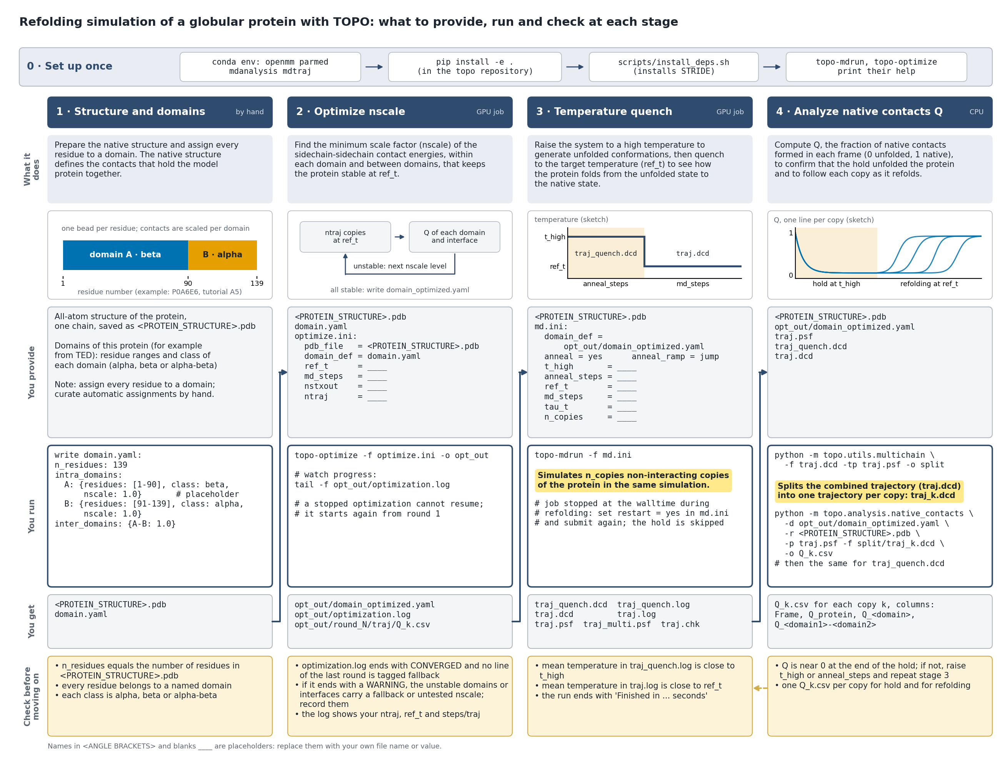

# Start here: a refolding simulation from a structure to Q curves

This page takes one globular protein from an all-atom structure to curves of the
fraction of native contacts, Q, against time after a temperature quench. It puts
four tutorials in the order you need them and adds the checks to make between
stages. Each stage links to the tutorial that explains it in detail.

The page covers single-chain globular proteins. A chain with disordered regions
needs the `disordered:` section of `domain.yaml`
([Tutorial A.7](A7_idr_mixed.md)).



*The temperature and Q panels in the figure are sketches, not simulation data.*

`<PROTEIN_STRUCTURE>` stands for the name of your structure file without `.pdb`.
Replace it, together with the angle brackets, in every command and control file.
Values that depend on your protein are written as `____`. They are listed in
[Values to choose](#values-to-choose).

| Stage | What you do | Command | Detail |
|---|---|---|---|
| 0 | Install TOPO and STRIDE | `pip install -e .` | [Installation](../modules/installation.rst) |
| 1 | Prepare the structure and assign domains | by hand | [Tutorial A.2](A2_multidomain.md), [Domain definition file](../usage/domain_definition.rst) |
| 2 | Find the `nscale` of each domain and interface | `topo-optimize` | [Tutorial A.5](A5_opt_nscal.md) |
| 3 | Unfold at high temperature, then quench | `topo-mdrun` | [Tutorial A.6](A6_anneal.md), [Tutorial A.4](A4_multicopy.md) |
| 4 | Compute Q for every copy | `topo.analysis.native_contacts` | [Native-contact (Q) analysis](../usage/native_contacts.rst) |

## What the model does

TOPO reads an all-atom PDB file and keeps one bead per residue at the C-alpha
position. The native structure defines which residue pairs attract each other,
and the dynamics are Langevin dynamics run with OpenMM. The side chain contact
energies inside each domain and across each domain interface are multiplied by a
factor called `nscale`. If `nscale` is too low, the domain unfolds at the
simulation temperature. If it is too high, the fold is over-stabilized. Stage 2
picks the smallest `nscale` from a fixed list at which every domain and interface
stays folded. Stage 3 unfolds the protein at a high temperature and drops the
thermostat to the working temperature. Stage 4 measures how the native contacts
come back.

## Files you will handle

| File | Written by | Used in |
|---|---|---|
| `<PROTEIN_STRUCTURE>.pdb` | you | stages 2, 3, 4 |
| `domain.yaml` | you | stage 2 |
| `optimize.ini` | you | stage 2 |
| `opt_out/domain_optimized.yaml` | `topo-optimize` | stages 3, 4 |
| `opt_out/<PROTEIN_STRUCTURE>_stride.dat` | `topo-optimize` | stage 3 |
| `md.ini` | you | stage 3 |
| `traj_quench.dcd`, `traj.dcd`, `traj.psf` | `topo-mdrun` | stage 4 |
| `Q_*.csv` | `topo.analysis.native_contacts` | your plots |

## Stage 0. Set up once

Create an environment, install TOPO in editable mode, and install STRIDE, the
external program TOPO calls to assign backbone hydrogen bonds.

```bash
mamba create -n topo -c conda-forge python">=3.9" openmm parmed mdanalysis \
    mdtraj numpy pandas pyyaml
mamba activate topo
cd /path/to/topo
pip install -e .
scripts/install_deps.sh          # puts stride in $HOME/.local/bin
```

Confirm that the commands exist:

```bash
topo-mdrun                       # prints help
topo-optimize                    # prints help
python -c "import topo, openmm; print('OK', openmm.__version__)"
which stride
```

If `which stride` finds nothing, add `$HOME/.local/bin` to `PATH` or set
`TOPO_STRIDE` to the full path of the binary. TOPO looks for STRIDE in
`$TOPO_STRIDE`, then on `PATH`, then in `topo/bin/`
([External dependencies](../usage/external_dependencies.rst)).

The control files on this page set `device = GPU`, which selects the OpenMM CUDA
platform. Set `device = CPU` to run without a CUDA GPU.

Before your own protein, run tutorials [A.1](A1_single_domain.md),
[A.4](A4_multicopy.md), [A.5](A5_opt_nscal.md) and [A.6](A6_anneal.md) in that
order. Each finishes in seconds to minutes with its demo settings.

## Stage 1. Structure and domains

Make one working folder per protein and put the all-atom structure in it as
`<PROTEIN_STRUCTURE>.pdb`. The file must contain one chain. Count the residues:

```bash
grep -c '^ATOM.* CA ' <PROTEIN_STRUCTURE>.pdb
```

Assign every residue to a domain and give each domain a class. TOPO accepts three
class names: `alpha`, `beta` and `alpha-beta`.

One source of domain boundaries for AlphaFold Database models is TED, The
Encyclopedia of Domains (https://ted.cathdb.info; Lau et al., Science 2024,
doi:10.1126/science.adq4946). Search TED with the UniProt accession of your
model. For each domain TED gives a `chopping` string with the residue ranges. A
domain made of several segments is written with underscores, so a chopping of the
form `11-41_290-389` becomes `residues: [11-41, 290-389]` in `domain.yaml`. TED
also gives a `cath_label` when it can assign one. The first number of a CATH
label is the class: 1 is `alpha`, 2 is `beta`, and 3 is `alpha-beta`.
[AUTHOR: rule for a domain with no CATH label or with CATH class 4.]

TED can leave residues outside every domain, for example linkers and chain ends.
Assign those residues by hand, so that every residue from 1 to `n_residues`
belongs to a named domain. [AUTHOR: rule for choosing the domain of a residue
that TED leaves unassigned.]

This `domain.yaml` is the two-domain protein of Tutorial A.5:

```yaml
n_residues: 139
intra_domains:
  A:
    residues: [1-90]
    class: beta
    nscale: 1.0        # placeholder, the optimizer replaces it
  B:
    residues: [91-139]
    class: alpha
    nscale: 1.0        # placeholder
inter_domains:
  A-B: 1.0             # placeholder
```

For a single-domain protein, write one domain that covers residues 1 to N and
leave out `inter_domains`.

Mistakes that stop the run with an error:

- `n_residues` differs from the residue count of the PDB file.
- A domain has no `class`. The optimizer needs it for every domain.
- A domain has no `nscale`. `topo-mdrun` needs a number, even as a placeholder.
- A domain name contains a hyphen. The hyphen separates the two names in an
  `inter_domains` key.

Mistakes that give no error:

- A residue in no domain is placed in an automatic domain `X` with `nscale` 1.0.
  The optimizer never adjusts `X`, and a domain of your own must not be named `X`.
- A residue listed in two domains is assigned to the one written later in the
  file.
- A misspelled `inter_domains` key in a file you write by hand is ignored, and
  that interface stays at 1.0. The optimizer writes all interface keys itself, so
  this applies only to files you edit after stage 2.
- Residue numbers are positions in the chain, counted from 1 in the order of the
  PDB file. They are not the residue numbers printed in the PDB file if those do
  not start at 1.

Check that the file parses:

```bash
python -c "import yaml; print(yaml.safe_load(open('domain.yaml')))"
```

## Stage 2. Optimize nscale

Write `optimize.ini`:

```ini
pdb_file   = <PROTEIN_STRUCTURE>.pdb
domain_def = domain.yaml
ref_t      = ____      ; K, temperature of the stability test
md_steps   = ____      ; steps per trajectory
nstxout    = ____      ; steps between saved frames; these frames are scored
nstlog     = ____
ntraj      = ____      ; independent trajectories per round
device     = GPU
```

Run it:

```bash
topo-optimize -f optimize.ini -o opt_out
```

In each round the optimizer runs `ntraj` independent copies of the protein at
`ref_t` in one simulation and computes Q for every domain and interface in every
saved frame. A domain or interface is stable if, in every trajectory, Q is above
`q_threshold` in at least `frame_fraction` of the frames. Each unstable domain or
interface moves up one level in the `nscale` list of its class, and the next
round starts. [Tutorial A.5](A5_opt_nscal.md) gives the levels, and
[Optimizer control options](../usage/optimization_control.rst) gives every key
and its default.

A domain or interface that is still unstable at level 5 is set to the fallback
value, which is level 3 of its class, and this value is tested in one more round.
The optimizer stops when everything is stable, when every unstable domain or
interface is already at the fallback value, or after `max_rounds` rounds.
`domain_optimized.yaml` is written in all three cases, so its presence does not
show that the optimization succeeded.

Outputs in `opt_out/`:

- `domain_optimized.yaml`: the same domains with the selected `nscale` values.
- `optimization.log`: the native contact count of each domain and interface, then
  for each round the `nscale` values tested and the folded fraction of each
  trajectory.
- `<PROTEIN_STRUCTURE>_stride.dat`: the STRIDE output, computed once.
- `round_N/`: the `domain.yaml` and `md.ini` of round N, and in `round_N/traj/`
  the trajectories and one `Q_k.csv` per copy.

Follow a running optimization with `tail -f opt_out/optimization.log`.

Checks before stage 3:

- The last line of `optimization.log` starts with `# CONVERGED`.
- No line in the last `## Round` block carries the tag `fallback`. A run can end
  with `# CONVERGED` at the fallback value. That domain or interface was unstable
  at the same value in an earlier round and at the two levels above it, so record
  it.
- If the log ends with a `WARNING` block, it names the domains or interfaces that
  are still unstable. Their `nscale` in `domain_optimized.yaml` is the fallback
  value, or, if `max_rounds` was reached first, one level above the last level
  tested. That value was never simulated.
- The header line (`# ntraj=... T=... K Q>... for >=...% of frames`) shows your
  `ntraj` and `ref_t`, and the line `running N-copy MD (... steps/traj)` in each
  round shows your `md_steps`. A misspelled key in `optimize.ini` gives no error,
  and the default is used.

Three properties of the optimizer to plan for:

- If `md_steps` is missing, the default is 10,000 steps (150 ps at the 15 fs
  time step). That length cannot distinguish a folded domain from an unfolded
  one.
- `n_copies`, `output_dir` and `outname` in `optimize.ini` are ignored. The
  optimizer sets them itself.
- A stopped optimization cannot be resumed. A new call starts again from round 1,
  so a job time limit must cover all rounds.

## Stage 3. Temperature quench

Write `md.ini`:

```ini
pdb_file   = <PROTEIN_STRUCTURE>.pdb
model      = topo
domain_def = opt_out/domain_optimized.yaml
stride_output_file = opt_out/<PROTEIN_STRUCTURE>_stride.dat

dt     = 0.015         ; ps
tcoupl = yes
ref_t  = ____          ; K, refolding temperature
tau_t  = ____          ; ps^-1, Langevin friction

anneal       = yes
anneal_ramp  = jump    ; thermostat drops from t_high to ref_t in one step
t_high       = ____    ; K, unfolding temperature
anneal_steps = ____    ; steps held at t_high
md_steps     = ____    ; steps at ref_t after the jump

n_copies   = ____      ; independent copies of the chain in this run
copy_shift = 5.0       ; nm, starting offset between copies

pcoupl = no
pbc    = no
output_dir = quench_run1
outname    = traj
nstxout = ____
nstlog  = ____
restart  = no
minimize = no
device   = GPU
```

`stride_output_file` reuses the STRIDE output of stage 2. Without this key,
`topo-mdrun` runs STRIDE again at every start and writes
`<PROTEIN_STRUCTURE>_stride.dat` in the directory it was started from.

Run it:

```bash
topo-mdrun -f md.ini
```

The run has two phases, and each writes its own files in `output_dir`. The hold
at `t_high` lasts `anneal_steps` steps and writes `traj_quench.dcd` and
`traj_quench.log`. The refolding phase at `ref_t` lasts `md_steps` steps and
writes `traj.dcd` and `traj.log`, with the step counter starting again from 0.
The copies do not interact, so one run with `n_copies` copies gives `n_copies`
independent refolding trajectories. Other files in the folder are `traj.psf`
(topology of one chain), `traj_multi.psf` (topology of all copies), `traj.chk`
(checkpoint of the refolding phase), `traj_final.pdb` and
`<PROTEIN_STRUCTURE>_CA.pdb` (the native structure at one bead per residue).

After a change of the thermostat temperature the chain needs a time of about
`1/tau_t` to follow it. The hold must last many times `1/tau_t`, and long enough
for the chain to lose its native contacts. Tutorial A.6 uses `tau_t = 1.0` so
that its demo finishes in seconds. Do not copy its `tau_t` and `anneal_steps`.

Checks:

- The standard output ends with `--- Finished in ... seconds ---`.
- The mean temperature in each log is close to the set value. Single frames of a
  small chain fluctuate, so compare the mean.

```python
import numpy as np
from topo.reporter.topo_reporter import readOpenMMReporterFile
for f in ["quench_run1/traj_quench.log", "quench_run1/traj.log"]:
    d = readOpenMMReporterFile(f)
    print(f, round(np.array(d["Temperature (K)"]).mean()), "K")
```

Practical points:

- Every fresh run overwrites the files in its `output_dir`. Give each run its own
  folder name.
- If the run stops during the refolding phase, set `restart = yes`, keep
  `output_dir`, `outname` and all protocol keys unchanged, and start it again.
  The run skips the hold and continues from `traj.chk`. `md_steps` stays the
  total length of the refolding phase. If the run stops during the hold, no
  checkpoint exists and the restart begins again with the hold.
- Leave `nstcomm` unset when `n_copies` is larger than 1.

## Stage 4. Analyze the fraction of native contacts Q

Q is the fraction of native contacts that are formed in a frame, from 0
(unfolded) to 1 (native). The native contacts are taken from the all-atom
`<PROTEIN_STRUCTURE>.pdb`: two residues more than 3 apart in sequence with any
pair of heavy atoms within 4.5 Angstrom. A contact counts as formed in a frame
when the C-alpha distance is at most 1.2 times its native value. The number of
contacts in this list differs from the `native contacts` number TOPO prints when
it builds the model, because the model uses its own contact definition for the
energies.

A run with `n_copies` larger than 1 writes one combined trajectory, in which
every frame holds all copies of the chain. The Q scorer accepts only a trajectory
with one bead per residue of the reference structure, so split both combined
trajectories into one file per copy, then score each file:

```bash
mkdir -p split Q
python -m topo.utils.multichain -f quench_run1/traj.dcd \
    -tp quench_run1/traj.psf -o split --outname traj
python -m topo.utils.multichain -f quench_run1/traj_quench.dcd \
    -tp quench_run1/traj.psf -o split --outname traj_quench

for f in split/*.dcd; do
  k=$(basename "$f" .dcd)
  python -m topo.analysis.native_contacts -d opt_out/domain_optimized.yaml \
      -r <PROTEIN_STRUCTURE>.pdb -p quench_run1/traj.psf -f "$f" -o "Q/Q_${k}.csv"
done
```

This writes `Q/Q_traj_quench_k.csv` (hold) and `Q/Q_traj_k.csv` (refolding) for
each copy k. Each file has one row per frame and the columns `Frame`, `Q_protein`
(all native contacts), one `Q_<domain>` per domain, and one
`Q_<domain1>-<domain2>` per interface.

Check the hold first, then plot the refolding curves:

```python
import glob
import pandas as pd
import matplotlib
matplotlib.use("Agg")
import matplotlib.pyplot as plt

dt = 0.015        # ps, from md.ini
nstxout = ____    # steps between saved frames, from md.ini

for f in sorted(glob.glob("Q/Q_traj_quench_*.csv")):
    q = pd.read_csv(f)
    print(f, "mean Q over last 10 frames of the hold:",
          round(q["Q_protein"].tail(10).mean(), 3))

fig, ax = plt.subplots()
for f in sorted(glob.glob("Q/Q_traj_[0-9]*.csv")):
    q = pd.read_csv(f)
    ax.plot((q["Frame"] + 1) * nstxout * dt / 1000, q["Q_protein"], lw=0.8)
ax.set_xlabel("time at ref_t (ns)")
ax.set_ylabel("Q, whole protein")
ax.set_ylim(0, 1)
fig.savefig("Q_refolding.png", dpi=200)
```

Checks:

- Q is near 0 at the end of the hold in every copy. If the chain kept part of its
  native structure, the refolding curves are biased by it. Raise `t_high` or
  `anneal_steps` and repeat stage 3. [AUTHOR: the Q value you accept at the end
  of the hold; the lab guide uses 0.2.]
- There is one refolding file and one hold file per copy.

## Running on a cluster

Stages 2 and 3 are the expensive ones and usually run as batch jobs on a GPU
node. A Slurm job script has this shape. The account, partition and GPU request
depend on your site.

```bash
#!/bin/bash
#SBATCH --job-name=____
#SBATCH --account=____
#SBATCH --partition=____
#SBATCH --gpus=1
#SBATCH --time=____

# activate the environment explicitly; a batch job does not always
# inherit the environment of your login shell
conda activate topo
cd $SLURM_SUBMIT_DIR
topo-optimize -f optimize.ini -o opt_out      # stage 2
# topo-mdrun -f md.ini                        # stage 3
```

Two points apply to any scheduler. The stage 2 job must be able to find STRIDE,
so `PATH` or `TOPO_STRIDE` must be set inside the job. The time limit of the
stage 2 job must cover all rounds, because the optimizer cannot resume.

## Values to choose

| Key | File | Meaning |
|---|---|---|
| `ref_t` | `optimize.ini` | temperature of the stability test (K) |
| `md_steps` | `optimize.ini` | steps per stability trajectory |
| `nstxout` | `optimize.ini` | steps between scored frames |
| `ntraj` | `optimize.ini` | trajectories per round |
| `ref_t` | `md.ini` | refolding temperature (K) |
| `tau_t` | `md.ini` | Langevin friction (ps^-1) |
| `t_high` | `md.ini` | unfolding temperature (K) |
| `anneal_steps` | `md.ini` | steps held at `t_high` |
| `md_steps` | `md.ini` | steps at `ref_t` after the jump |
| `n_copies` | `md.ini` | refolding trajectories per run |
| `nstxout` | `md.ini` | steps between saved frames |

## What this page was checked against

The commands, keys, file names and defaults on this page were checked against the
TOPO source at commit fc03be2 (2026-09-07). If a command or key fails with a
later version, compare it with the README of the matching tutorial.
